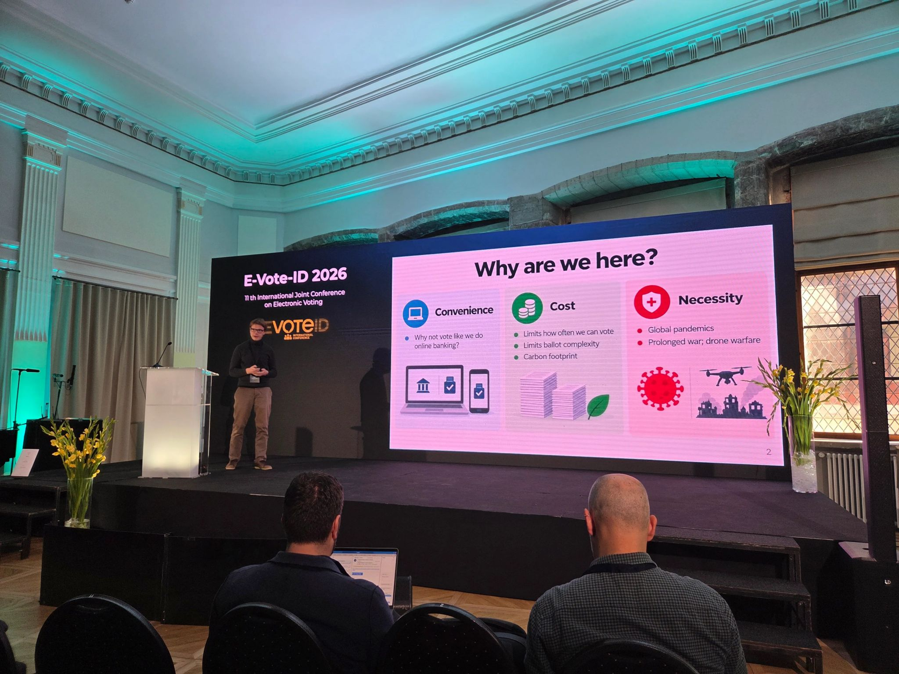

+++
date = "2026-10-12"
rss = "It was a great joy to attend this year's E-Vote-ID conference in Tallinn. It also left me with some sorrow: as things stand, I will most likely not be able to attend next year's edition in Toronto, because paying for it out of my own pocket would be prohibitively expensive. That is a pity, as I already have several ideas I would like to write up and submit there."
tags = ["evote"]
+++

# Reflection on E-Vote-ID 2026

It was a great joy to attend this year's E-Vote-ID conference in Tallinn. It also left me with some sorrow: as things stand, I will most likely not be able to attend next year's edition in Toronto, because paying for it out of my own pocket would be prohibitively expensive. That is a pity, as I already have several ideas I would like to write up and submit there.

## The conference

The conference was organised to a remarkably high standard. The venue was spacious yet cosy, well sized for the roughly 150 attendees the organisers reported, and it balanced a relaxed atmosphere with a professional one. The poster and demo area was well chosen, with little obstruction between presenters, and I eventually came to like the use of presentation screens instead of printed posters. All of this served the real purpose of any conference, networking and knowledge sharing, very well. And the gala dinner, held among an exhibition in a museum, was unmatched.

## Why I came, and how it went

This was my third time at E-Vote-ID. Previously I had only presented posters; this year my paper, [Deniable Vote Updating with Eligibility Verifiability via Trapdoor Chains](https://link.springer.com/chapter/10.1007/978-3-032-39512-2_2), was also accepted in the technical track, which gives me my first real credential in the field. The paper is also a good starting point: I have four further paper ideas related to the same problem lined up, and they will be easier to develop because I can build on argumentation that is already written down. Pursuing them as an independent researcher, however, carries too much personal cost. That is why I am looking for a postdoctoral position, and finding one was my main goal in attending.

I spoke with many researchers, vendors and people from election management bodies, yet I feel I could have prepared better. In my defence, I had gone through the proceedings, knew the main ideas being presented, and had pitched my own talk to reach as broad an audience as possible. Where I fell short was in preparing points of contact with the long-standing figures in the field.

Three things went differently than I had hoped. First, I expected to meet people from the Latvian election management body, but no one from it attended, which was a missed opportunity. Their experience deploying optical scanners would have been valuable, and roughly half of the conference concerned optically scanned ballots and risk-limiting audits, topics directly relevant to their agenda. Second, some researchers with whom I have had interesting correspondence in the past simply did not attend. Third, there were researchers I failed to engage with at all: they looked extremely busy, and I did not have a good conversation starter ready. That one is on me.

## Technical highlights

I particularly enjoyed this year's technical papers and presentations, all of which are open access in the [proceedings](https://link.springer.com/book/10.1007/978-3-032-39512-2). MAYAsk, presented by Thi Van Thao Doan, proposes a more efficient re-encryption shuffle construction that significantly compresses proof sizes while also improving performance. Rosario Giustolisi presented a [simple protocol for tracker-based voting](https://link.springer.com/chapter/10.1007/978-3-032-39512-2_5) that distils the ideas behind the earlier Surtr design into something much easier to grasp, and the paper is far more accessible as a result. Leonardo Kimura presented [FiltrumVote](https://link.springer.com/chapter/10.1007/978-3-032-39512-2_7), a competing approach to the cleansing verifiability system I presented. It was clever: it combines disjunctive zero-knowledge proofs with sorting while staying safe from the 1009 attack in the selection phase.

[École](https://link.springer.com/chapter/10.1007/978-3-032-39512-2_9), presented by Florian Moser, was very cool as well. It anonymises the petition-signing process using concurrently running collections, which removes the need for an anonymous channel. Peter Rønne raised a concern, however, that this could be abused through a lottery in which someone like Elon Musk promises prize money in exchange for signatures, so receipt-freeness may need to be considered too.

I was also pleased with how my own presentation went. It drew several good questions, and more came during the poster session from people trying to understand the details.

## Blind signatures are back

Looking at the ideas that ran through the conference, the outlook is controversial. Blind signatures are back on the agenda of several groups, despite the problems researchers have long warned about. There are two of them. If the ballot itself is blindly signed, the issuance of the signature and the submission of the ballot to the bulletin board are strongly correlated in time, so anonymity depends on an anonymous channel that is hard to guarantee in practice. If instead a pseudonym is blindly signed and later used to vote, every voter who does not participate becomes an opportunity for the registrar to cast a ballot in their place.

I understand the appeal well: when I first explored pseudonymous voting, both blind signatures and linkable ring signatures came onto my radar. Eventually I stumbled on exponentiation mixes almost by accident: they are efficient and leave the registrar no room to cheat. That made me appreciate Wikström's shuffle proofs, and the absence of an implementation drove the [PeaceFounder](https://peacefounder.org) project for a while.

There were two practitioners' talks on this topic, and I was the only one challenging the registrar trust assumption. I find that concerning. And we will likely hear more about them with the post-quantum transition, since fairly efficient post-quantum blind signatures exist and can therefore scale.

## The post-quantum transition

The second stream concerned the post-quantum transition. The keynote speaker presented a recommendation that vendors building new systems should use post-quantum cryptography. Aleksander Essex then raised a point about factorisation records and whether we should wait to see real progress before acting.

I raised two points. The first concerns integrity. Suppose that in 20 years a quantum computer is built on one of today's most promising architectures, such as IonQ's, which requires only around 20,000 physical qubits. Breaking the discrete logarithm for P-256 on such a machine would still take around 26 days per attempt, going by IonQ's own estimate for a comparable 256-bit curve ([PostQuantum.com — IonQ secp256k1 estimate](https://postquantum.com/post-quantum/ionq-secp256k1-resource-estimate/); [Emergent Mind — IonQ paper summary](https://www.emergentmind.com/papers/2609.05625)). That is enough time to set up fresh classical parameters, collect the ballots, and run a verifiable mixnet whose proofs are published on the bulletin board, all before an attacker could break the keys. The threat to integrity therefore does not really apply. And if it does begin to materialise, the key size can be increased in step with it.

The second concerns privacy. Encrypted votes are only computationally private, whether the encryption is classical or post-quantum, so future advances in algorithms could eventually allow them to be decrypted. Switching to post-quantum encryption does not solve this. Everlasting privacy comes from perfectly hiding commitments, and classical cryptography already offers well-understood structures for this, such as Pedersen commitments, which combine well with re-encryption shuffles.

## Estonia and post-quantum primitives

It is interesting that Estonia is investigating incorporating post-quantum primitives. One researcher told me in conversation that shuffling 100,000 post-quantum ciphertexts can take around 48 hours, whereas an ElGamal re-encryption shuffle over the P-256 curve takes about 60 seconds, with proof generation included in both cases. Proof generation can be parallelised, but then deployment requires an HPC node, and the proofs become harder to audit independently.

In addition, decryption in such a scheme is n-of-n, so any single corrupt server can block the election result. As I learned at the conference, this is not a problem for Estonia, because there the key is reconstructed from its shares before decryption, rather than partial decryptions being combined as the state of the art expects.

## Radical transparency

A panellist on the third day said that Estonia's path to internet voting could not be repeated today, because the current environment is not fertile ground for national internet voting. I tend to agree. Scepticism towards e-voting systems is at its highest, and there is no room for mistakes.

The Estonian deployment also illustrates well how institutional memory can perpetuate bad practices. It still relies on a single mix server, which makes anonymity weak, and a single server for key generation and for reconstructing the key before decryption. Both are in clear conflict with the state of the art. Ironically, this same design is what makes the post-quantum transition easier for them, and the transition risks pouring a concrete layer over these weaknesses.

One solution the panellist suggested was radical transparency. For me, this means that all cryptographic evidence must be publicly available, with no reliance on internal audits, and that this evidence must prove the published tally was computed from accepted ballots, cryptographically signed by voters listed in the registration roll. This would also simplify deployment, since there would be no internal auditing parties to select and manage. Publicly available evidence would also be fertile ground for a new generation to learn cryptography by verifying the proofs themselves, motivated by the chance to prove themselves on high-stakes data. With AI tools at hand, there has never been a better time to learn these things.

In an Estonian-like system that implements revoting, internal audits are a necessity, because coercers could misuse the audit data to check how voters participated. Furthermore, ElGamal-encrypted votes could be decrypted in the future by a computationally unbounded adversary, which also prevents the ballot signatures from being published. This is precisely the problem my paper at this year's conference tackles. Cleansing verifiability lets anyone check that superseded ballots were correctly removed before tallying, and combined with practical everlasting privacy it would let all the evidence be published, without handing coercers, today or decades from now, a way to see who disobeyed.

## Looking ahead

Tallinn left me with a clearer picture of where the field is heading and where my work fits: blind-signature schemes that need closer scrutiny of the registrar's role, a post-quantum debate that risks overlooking everlasting privacy, and a call for radical transparency that existing deployments cannot yet answer. I have four papers' worth of ideas building on this year's submission, and I would like to develop them within a postdoctoral position rather than at my own expense. Whether or not I make it to Toronto, I intend to keep pushing these questions, and next time to arrive with a conversation starter for everyone I hope to meet.
